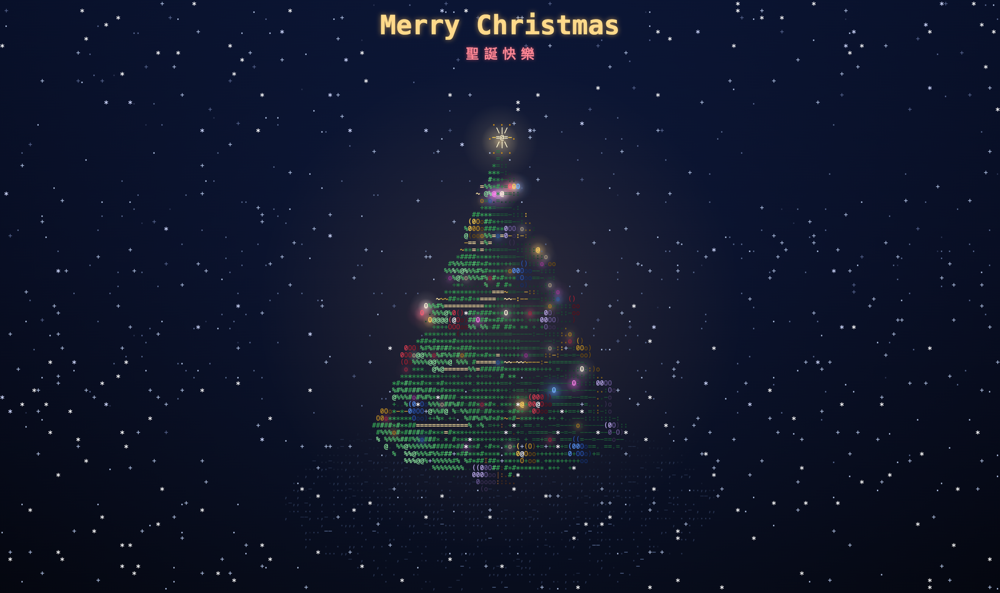
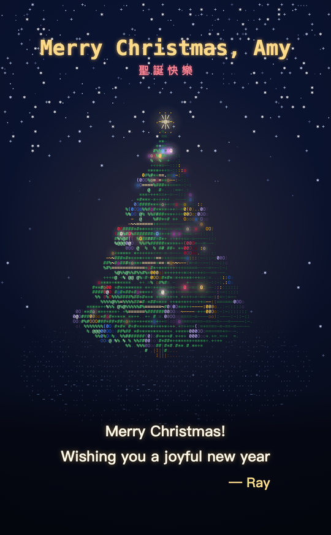
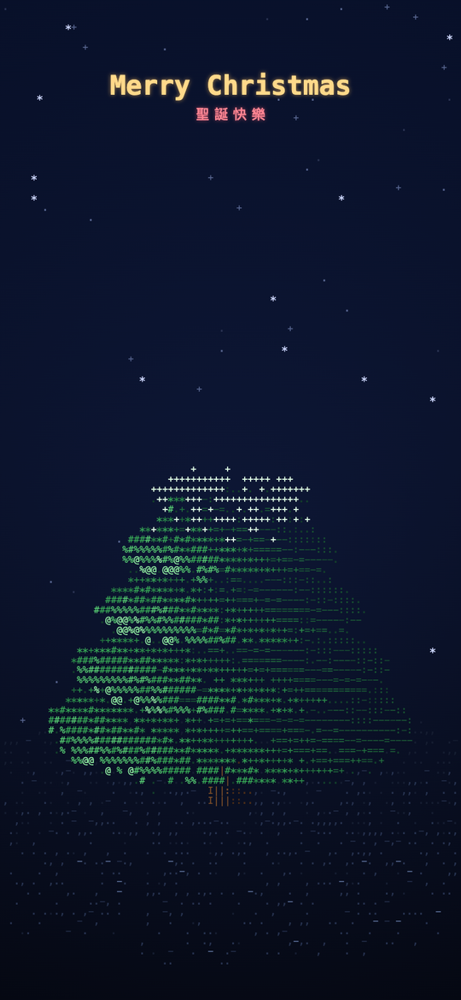
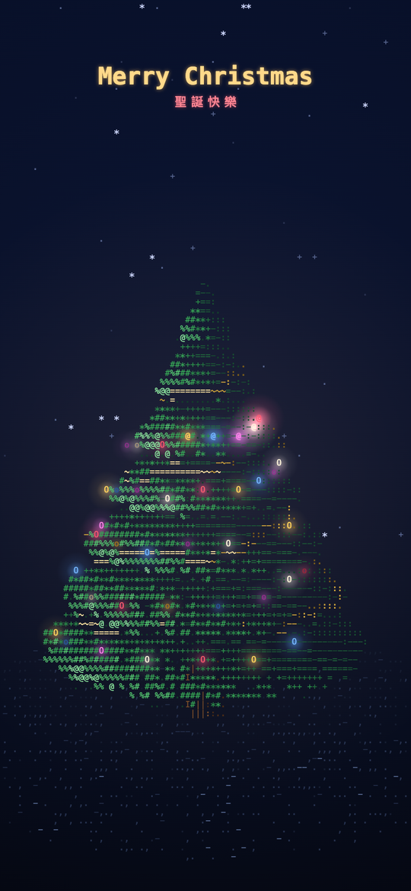
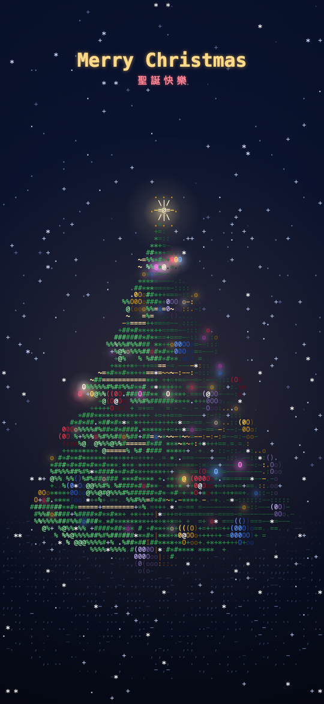

# ASCII Christmas Tree 🎄

**A 3D ASCII Christmas tree in a single HTML file — no frameworks, with synthesized music.**

**English** · [繁體中文](README.zh-TW.md)

### ▶ [Live demo](https://raypan891108.github.io/ChristmasTree/) · [Example card for “Amy”](https://raypan891108.github.io/ChristmasTree/?to=Amy&msg=Merry%20Christmas!%7CWishing%20you%20a%20joyful%20new%20year&from=Ray)

<p align="center">
  
</p>

- **One file.** Everything lives in `index.html`: no frameworks, no build step, no images or audio files to download.
- **Real 3D, drawn with characters.** About 20,000 points are rotated, projected and depth-tested onto a character grid with Canvas 2D.
- **Music made in the browser.** Jingle Bells is synthesized live with the Web Audio API, and the lights flash on the beat.
- **Send it to someone.** Add a name and a message to the URL and the tree becomes a personal Christmas card.



> Browsers block sound until you interact with the page, so tap anywhere once to start the music. It picks up exactly where the animation is.

## Send it to someone

Tap **✉** at the top right, fill in a name, a message and your signature, then copy the link. Or build the URL yourself:

```
https://raypan891108.github.io/ChristmasTree/?to=Amy&msg=Merry%20Christmas!%7CWishing%20you%20a%20joyful%20new%20year&from=Ray
```

| Parameter | What it does | Limit |
| --- | --- | --- |
| `to` | Puts the name in the title: *Merry Christmas, Amy* | 20 characters |
| `msg` | Types the message under the tree after the star lights up. Separate lines with a line break or `\|` | 3 lines, 60 characters each |
| `from` | Signs the message: *— Ray* | 20 characters |

The text is only ever drawn onto the canvas, never inserted into the page as HTML.

<p align="center">
  
</p>

## Screenshots

| 1. Title | 2. Growing | 3. Garland and lights | 4. Star and snow |
| :---: | :---: | :---: | :---: |
|  |  |  |  |

## How it works

1. **Point cloud.** The needles, trunk, ground, garland, lights and ornaments are about 20,000 points. Each point stores a position, a surface normal, a type and a birth time `t0`; a point is only drawn once the clock passes its `t0`, which is what makes the tree "grow".
2. **Projection and depth buffer.** Every frame the points are rotated around the Y axis and projected onto a grid of character cells. Each cell keeps only the point closest to the camera.
3. **Brightness to characters.** Lighting picks a character from `.:-=+*#%@`, and the point's type picks the color. Characters of the same color are joined into strings and drawn in one `fillText` call, which keeps phones at 60 fps.
4. **Audio as the clock.** Notes are scheduled ahead with Web Audio, and the animation reads the time the speakers are actually playing, so the lights land on the beat. If the audio is paused (the tab goes to the background, a phone call comes in), the animation falls back to a normal clock and the music rejoins on the next tap.

## Timeline

The music runs at 144 BPM, so one bar is about 1.67 seconds; every stage starts on a bar line.

| Time | What happens |
| --- | --- |
| 0–3 s | Starry sky; `Merry Christmas` types itself and 聖誕快樂 fades in |
| 3–13 s | Ground and trunk appear, then the needles grow from the bottom up |
| 13–21 s | A gold garland spirals up, 110 lights switch on one by one, then the ornaments appear |
| ~21.7 s | The star lights up with a flash and a burst of sparks |
| After that | Snow falls; the lights flash on the beat and change pattern every 4 bars. A personal message, if any, is typed out at about 24 s |

The song plays an intro, chorus, verse and a glockenspiel chorus an octave up, about 83 seconds in total, then loops.

## Controls

| Control | Effect |
| --- | --- |
| Tap the screen | The first tap starts the music; after that, every tap throws sparks and flashes all the lights |
| ✉ | Make a personal card link |
| 🔊 / `M` | Sound on/off |
| ↻ / `R` | Replay from the start |
| ● | Record a video from the start; tap again to stop and download it (`.webm` in Chrome, `.mp4` in Safari) |
| `</>` | View the source on GitHub |

## Run it locally

Double-click `index.html`, or serve the folder:

```bash
python3 -m http.server 8000
```

Then open http://localhost:8000. Two extra URL parameters help while tweaking:

| Parameter | Effect |
| --- | --- |
| `?t=20` | Start at second 20 |
| `?debug` | Show rotation, character count, lights, FPS and the current time |

## Customize

All of these are constants near the top of the `<script>` in `index.html`:

| To change | Constant |
| --- | --- |
| Tempo | `BPM` |
| When each stage happens | `TL` (in bars, `BAR`) |
| Tree size and number of tiers | `TREE_H`, `R0`, `TIERS` |
| Character density (tree width in characters) | `TARGET_COLS` |
| Number of points | `N_LEAF`, `N_LIGHTS`, `N_ORN`, … |
| Rotation speed | `ROT_SPEED` |
| Colors | the `P_LEAF`, `P_LIGHT`, `P_ORN`, … palettes |
| Melody | `CHORUS`, `VERSE` as `[MIDI note, beats]` |

## License

- Code: [MIT](LICENSE).
- Music: *Jingle Bells* (James Lord Pierpont, 1857) is in the public domain. It is synthesized in code; no recordings are used.
