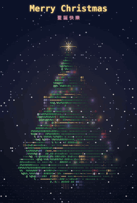
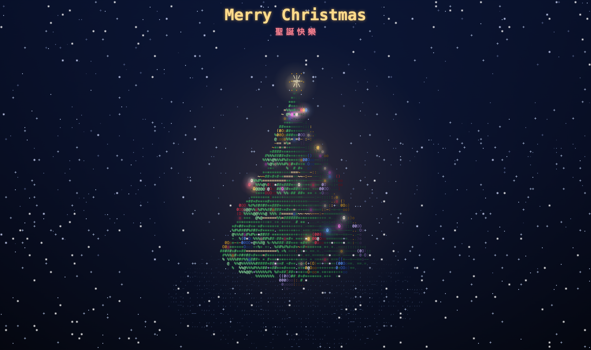
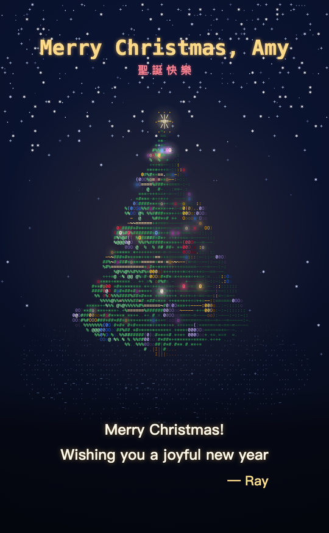
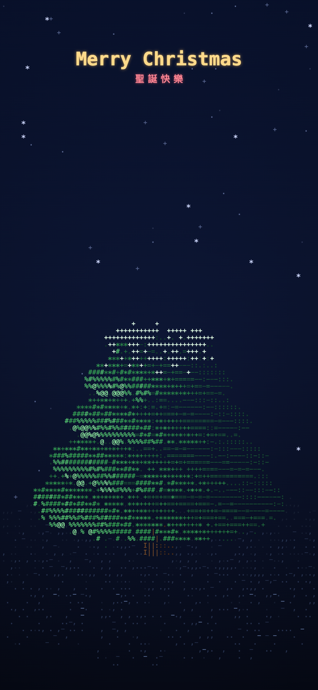
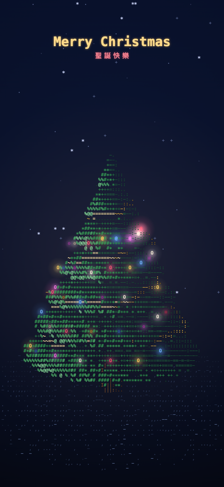
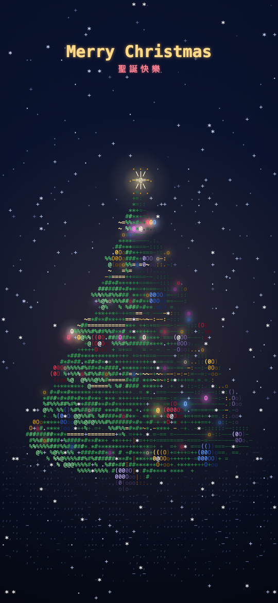

# ASCII 聖誕樹 🎄

**用一個 HTML 檔案，做出會跟音樂閃爍的 3D ASCII 聖誕樹。不用任何框架，音樂也是程式即時合成的。**

[English](README.md) · **繁體中文**

### ▶ [線上看](https://raypan891108.github.io/ChristmasTree/) · [送給「小美」的範例卡片](https://raypan891108.github.io/ChristmasTree/?to=%E5%B0%8F%E7%BE%8E&msg=%E7%A5%9D%E4%BD%A0%E8%81%96%E8%AA%95%E5%BF%AB%E6%A8%82%7C%E6%96%B0%E7%9A%84%E4%B8%80%E5%B9%B4%E4%B9%9F%E8%A6%81%E9%96%8B%E5%BF%83&from=Ray)

<p align="center">
  
</p>

- **只有一個檔案**：全部都在 `index.html`，不用框架、不用打包，也不載入任何圖片或音檔。
- **真的 3D，用字元畫出來**：約 2 萬個點經過旋轉、透視投影和深度判斷，再用 Canvas 2D 畫成字元。
- **音樂在瀏覽器裡現場合成**：用 Web Audio 合成 Jingle Bells，彩燈會跟著節拍閃。
- **可以送給別人**：網址加上名字和祝福語，就變成一張專屬的聖誕卡。



> 瀏覽器規定網頁要等使用者互動後才能發出聲音，所以請先點一下畫面，音樂會從動畫目前的位置接上。

## 送一棵聖誕樹給朋友

點右上角的 **✉**，或星星亮起後（有祝福語時是打完字後）短暫出現的「**🎄 也做一張送給朋友**」按鈕，填好收件人、祝福語和署名，再複製連結就好。也可以自己組網址：

```
https://raypan891108.github.io/ChristmasTree/?to=小美&msg=祝你聖誕快樂|新的一年也要開心&from=Ray
```

| 參數 | 作用 | 限制 |
| --- | --- | --- |
| `to` | 把名字放進標題：*Merry Christmas, 小美* | 20 個字 |
| `msg` | 星星亮起後，在樹下逐行打出祝福語；用換行或 `\|` 分行 | 最多 3 行，每行 60 個字 |
| `from` | 在祝福語最後署名：*— Ray* | 20 個字 |

這些文字只會畫在畫布上，不會被當成 HTML 放進網頁。

<p align="center">
  
</p>

## 畫面

| 1. 開場打字 | 2. 長樹 | 3. 掛彩帶與彩燈 | 4. 星星與飄雪 |
| :---: | :---: | :---: | :---: |
|  |  |  |  |

<details>
<summary>完整長樹過程動畫（2.5 倍速）</summary>
<p align="center">
  
</p>
</details>

## 運作原理

1. **3D 點雲**：樹葉、樹幹、地面、彩帶、彩燈、彩球共約 2 萬個點。每個點記錄位置、法向量、類型和出生時間 `t0`，時間到了才畫出來，看起來就像慢慢長出來。
2. **投影與深度緩衝**：每一格畫面先繞 Y 軸旋轉，再透視投影到字元網格；同一格只留最靠近鏡頭的點。
3. **亮度轉字元**：依光照亮度從 `.:-=+*#%@` 挑字元，依類型上色。同一列、同顏色的字元串成一個字串，用一次 `fillText` 畫完，不必每個字元各呼叫一次。手機尺寸、下雪時，每格畫面約 2,600 個字元只需約 770 次繪製呼叫，改善行動裝置效能。
4. **音樂當時鐘**：音符用 Web Audio 預先排程，畫面讀的是喇叭實際播到的時間，所以燈光會準確落在拍子上。
   - 切到背景時，動畫和音樂會一起暫停，回來後從離開的地方繼續。
   - 如果瀏覽器不讓音訊自己恢復（iPhone 常常如此），或音訊被來電等打斷，畫面會改用一般時鐘繼續播放，下次點畫面時音樂再從目前位置接上。

## 動畫流程

音樂速度 144 BPM，一小節約 1.67 秒，每一段都從小節開頭開始。

| 時間 | 畫面 |
| --- | --- |
| 0～3 秒 | 星空，`Merry Christmas` 打字出現，「聖誕快樂」淡入 |
| 3～13 秒 | 地面、樹幹先出現，樹葉由下往上長 |
| 13～21 秒 | 金色彩帶沿螺旋繞上去，110 顆彩燈依序亮起，接著掛上彩球 |
| 約 21.7 秒 | 頂端星星亮起，畫面閃一下並噴出火花 |
| 之後 | 開始飄雪；燈跟著節拍閃，每 4 小節換一種閃法。有祝福語時約 24 秒開始打字 |

音樂依序為前奏、副歌、主歌、高八度鐘琴副歌，全長約 83 秒，播完會循環。

## 操作

| 操作 | 效果 |
| --- | --- |
| 點畫面 | 第一次點會開始播音樂；之後每點一次，會撒出火花、所有燈一起亮一下 |
| ✉ | 製作專屬卡片連結 |
| 🔊 / `M` 鍵 | 開關聲音 |
| ↻ / `R` 鍵 | 從頭重播 |
| ● | 從頭開始錄影，再按一次停止並下載 MP4 或 WebM，依瀏覽器支援而定 |
| `</>` | 到 GitHub 看原始碼 |

畫面上的文字會跟著瀏覽器語言：中文瀏覽器顯示中文，其他一律顯示英文。

## 在自己電腦上跑

直接雙擊 `index.html`，或在這個資料夾開本機伺服器：

```bash
python3 -m http.server 8000
```

再打開 http://localhost:8000 。調整時可以用這兩個網址參數：

| 參數 | 作用 |
| --- | --- |
| `?t=20` | 直接從第 20 秒開始 |
| `?debug` | 顯示旋轉角度、字元數、燈數、FPS 和目前秒數 |

## 想調整的話

這些都是 `index.html` 裡 `<script>` 開頭附近的常數：

| 想改什麼 | 常數 |
| --- | --- |
| 音樂速度 | `BPM` |
| 各段動畫的時間 | `TL`（以小節 `BAR` 為單位） |
| 樹的大小、層數 | `TREE_H`、`R0`、`TIERS` |
| 字元密度（樹寬約幾個字） | `TARGET_COLS` |
| 點的數量 | `N_LEAF`、`N_LIGHTS`、`N_ORN` 等 |
| 旋轉速度 | `ROT_SPEED` |
| 顏色 | `P_LEAF`、`P_LIGHT`、`P_ORN` 等調色盤 |
| 旋律 | `CHORUS`、`VERSE`，格式是 `[MIDI 音高, 拍數]` |

## 授權

- 程式碼：[MIT](LICENSE)。
- 音樂：Jingle Bells（James Lord Pierpont，1857）的旋律已進入公有領域，由程式即時合成，沒有使用任何錄音檔。
